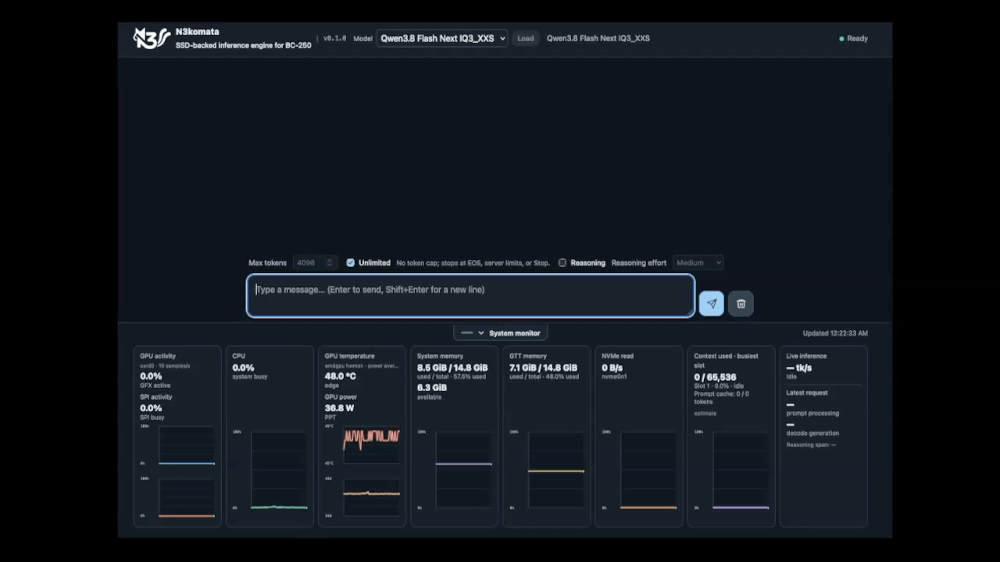

# N3komata

N3komata is a BC-250-focused project for **SSD-backed inference** of large
Mixture-of-Experts (MoE) models on a 16 GiB unified-memory system. Its target
models are much larger than the memory available to the machine, so the full
weight set cannot stay resident. Model weights remain in sharded GGUF files on
SSD and are accessed through memory mapping; only a working subset of experts
is kept in the Vulkan cache. N3komata keeps llama.cpp as its inference engine
and adds controls for choosing that working set and supplying cache misses.

The aim is to make models larger than available memory usable by trading off
inference quality, SSD read traffic, cache upload traffic, and response speed.
This is an experimental system: it does not make a 70 GiB model resident in 16
GiB. When an expert is absent from the Vulkan cache and its mapped pages are not
in the OS page cache, inference must wait for the SSD to supply those pages
before they can be uploaded and used.



## How SSD-backed inference works

For each token, the model router selects experts. N3komata checks whether their
weights are already in the Vulkan expert cache. Cached weights can be reused
directly. For a cache miss, the engine reads the corresponding range from the
mmap-backed GGUF shard, stages and uploads the expert weights, then continues
inference. The OS page cache may satisfy that read without physical SSD I/O, but
it competes with Vulkan allocations for the same UMA system memory. If neither
cache has the needed data, the SSD read is on the critical path.

This two-level reuse path is the central engineering problem: keep useful
experts in Vulkan memory, keep upcoming expert data readily available from the
mapped files or OS page cache, and avoid stalling the GPU while the storage path
services misses. N3komata's cache, quota, and prefetch controls target different
parts of that path; they do not remove the SSD dependency for a cold miss.

## What N3komata does

The llama.cpp MoE path is extended with several controls intended for the
BC-250's UMA memory hierarchy:

- **Expert cache:** selected expert weights are copied into a bounded Vulkan
  cache. A cache hit reuses the GPU-resident weights; a miss obtains the weights
  from the model's mmap-backed GGUF data and uploads them. The OS page cache can
  make a warm miss cheaper, but it is not guaranteed to retain the required
  expert pages.

- **Dynamic K:** instead of always executing the model's full routed top-K,
  router probabilities can choose how many experts to execute within a
  configured range. This is intended to address the BC-250's narrow PCIe 2.0 x2
  SSD link: executing fewer routed experts can reduce the expert weights that
  must be fetched from SSD, easing storage stalls. It does not increase the
  link's bandwidth, and it trades some model computation—and potentially
  quality—for lower expert demand. The release profile uses Vulkan-side
  router-mass selection with K=4..6 and cumulative router mass 0.60.

- **Per-layer byte-aware cache quota:** the default profile gives selected MoE
  layers extra cache slots using an experimentally derived map. It changes how
  the shared expert-cache capacity is distributed; it does not reduce the
  model's weight size. The map was measured with fixed K=3, so its combination
  with Dynamic K has not been benchmarked as a whole.

- **Expert prefetch and batched upload:** the engine can prepare expert data
  ahead within a layer and group uploads. The release profile uses same-layer
  prefetch and the batch-direct upload path.

These changes remain patches to llama.cpp and GGML, rather than a separate
inference engine. GPU slot-map lookup—which would let cache-hit routing remain
entirely on the GPU—is not enabled in this release profile.

## What has been measured

The available Qwen3.8 IQ3_XXS measurements show that decode speed depends
strongly on K, router-mass threshold, and cache state. They should not be
collapsed into one headline speed:

| Configuration | Cold decode | Warm decode | Scope |
|---|---:|---:|---|
| Fixed K=3, global SLRU | 10.571 tok/s | 11.570 tok/s | One prompt, 512 output tokens, one run per condition |
| Dynamic K=4..6, mass 0.60, global SLRU | 7.792 tok/s | 8.094 tok/s | Same study and prompt; CPU-side K selection |
| Dynamic K=4..6, mass 0.60, byte quota | 7.860 tok/s | 8.119 tok/s | Same study and prompt; CPU-side K selection |

These runs indicate that around 8 tok/s is a measured result for this Dynamic K
range, while fixed K=3 was faster in this particular prompt. In the same study,
held-out WikiText cross-entropy was 1.40825 for K=3 and 1.27935 for Dynamic K
(8 documents, 1,016 scored tokens), so the speed difference is part of a
quality/speed tradeoff. Each speed cell is a single 512-token run, not a stable
benchmark or a prediction for interactive use.
Byte quota changed speed by less than 1% in this study, with no consistent
direction across cold and warm runs.

A separate A/B isolated the location of the K-selection work. With K=4..8 and
router mass 0.80, two 512-token runs per arm measured 5.036 tok/s for Vulkan-side
selection and 4.927 tok/s for CPU-side selection, with matching output hashes.
That approximately 2.2% difference answers only whether this selection step
benefited from running in Vulkan for that workload. It is not the overall
performance of N3komata or of the release profile; its higher mass threshold
and K range select more experts than the default profile.

The release profile combines K=4..6, mass 0.60, byte quota, and Vulkan-side
selection. That exact combination has not yet had a controlled end-to-end
benchmark. The measurements above come from development experiments and do not
guarantee the same result from this standalone package. Results also depend on
prompt, cache state, SSD reads, and system memory pressure.

## Requirements

- AMD BC-250 with Vulkan-capable Mesa RADV
- Linux development tools: Git, CMake, a C/C++ compiler, Vulkan headers, and
  `glslc`
- Python 3.11 or newer
- Qwen3.8 Flash Next IQ3_XXS GGUF shards, downloaded separately
- Sufficient system memory for the OS and mapped model data; a desktop GUI can
  reduce the memory available to inference

## Install and run

1. Place both IQ3_XXS model shards in `models/`. See [`models/README.md`](models/README.md).
2. Build the patched llama.cpp engine:

   ```sh
   make build
   ```

3. Start terminal chat or the Web UI:

   ```sh
   make run
   make web
   ```

The first build fetches the pinned llama.cpp source and applies the N3komata
patch. The upstream revision and patch checksum are recorded in
[`engine/README.md`](engine/README.md). `make clean` removes generated engine
source and build files but leaves model files and links in `models/` untouched.

## License and model files

N3komata software is distributed under the MIT license. llama.cpp retains its
upstream license and notices. Model weights are not included and have separate
terms; the MIT license does not apply to them.
